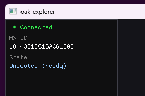
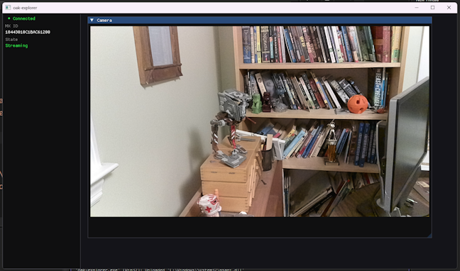
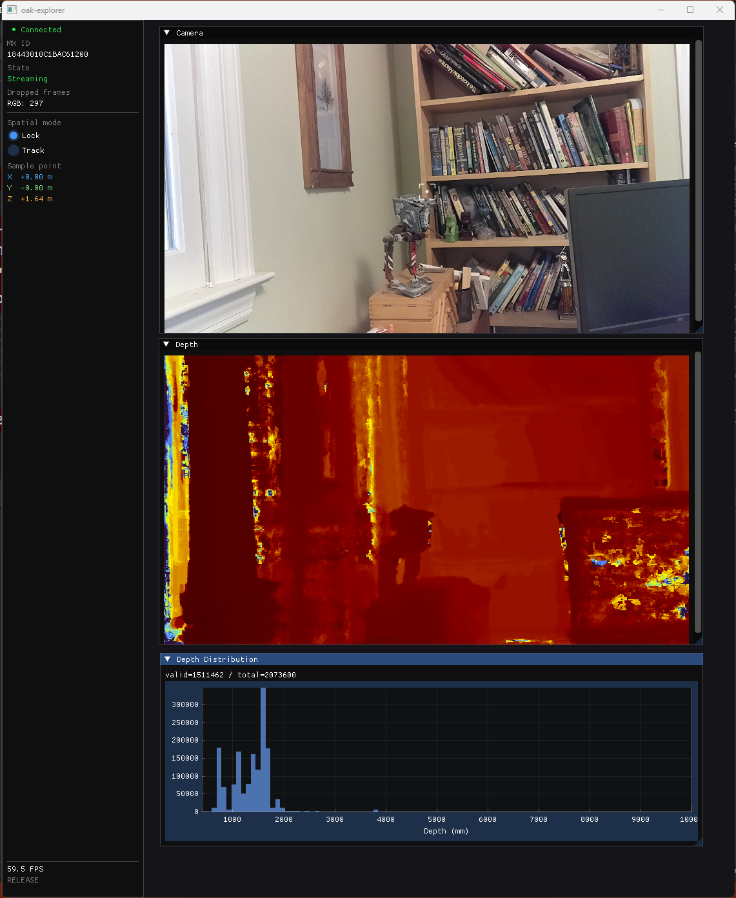

# oak-explorer

A Windows desktop application and C++ learning project for the [Luxonis OAK-D-Lite](https://shop.luxonis.com/products/oak-d-lite) depth camera. It uses DepthAI, Dear ImGui, ImPlot, GLFW, and OpenGL to display camera streams and sample 3D coordinates.

The current app implements Stages 1–5. CUDA acceleration is deferred; neural inference (Stage 6) is planned.

## Features and stages

| Stage | Feature | Status |
|---|---|---|
| 1 | Window, dockable ImGui layout, and device status | Complete |
| 2 | Live RGB camera stream | Complete |
| 3 | Stereo depth heatmap and depth histogram | Complete |
| 4 | Interactive spatial XYZ sampling | Complete |
| 5 | Depth filtering and flicker reduction | Complete; CUDA deferred |
| 6 | Neural inference and detection overlays | Planned |

### Stage 1 — Window and device status

- Creates a GLFW window with an OpenGL 3.3 core context and a dockable ImGui interface.
- Shows connection state, device MX ID, and whether the device is ready or in use.
- Persists the window geometry and ImGui layout beside the executable.



### Stage 2 — RGB camera stream

- `OakStreams` builds the DepthAI pipeline, owns the device and GL textures, and polls the RGB, depth, and spatial queues.
- The Camera window displays the live 1920×1080 RGB stream.
- If the camera is missing or the stream fails, the app keeps running and retries the pipeline every two seconds.



### Stage 3 — Stereo depth

- Left and right `MonoCamera` nodes feed a `StereoDepth` node using the `HIGH_DENSITY` preset.
- Depth is a uint16 millimetre value, aligned to the RGB camera. The output dimensions are taken from each frame.
- The Depth window shows a Turbo-coloured heatmap. Depth Distribution plots valid raw depth values; zero represents invalid depth.



### Stage 4 — Spatial sampling

- `SpatialLocationCalculator` measures a 5%×5% region of interest (ROI) and reports X, Y, and Z in metres.
- **Lock** mode samples where you click in the Camera window; **Track** mode follows the pointer while it is over the image.
- A reticle marks the current ROI, and the sidebar displays the coordinate readout.

### Stage 5 — Depth stability

- Enables left-right consistency, median, speckle, and temporal filtering in the device's `StereoDepth` pipeline.
- Applies host-side temporal smoothing and fills invalid display pixels from their 3×3 neighbourhood.
- CUDA acceleration is deferred; the current filter and display path uses the OAK device and CPU.

### Stage 6 — Neural inference (planned)

The planned stage is to run a `.blob` model on the OAK VPU and display detection overlays. It is not implemented yet.

## Controls and windows

- Choose **Lock** or **Track** in the sidebar to control spatial sampling.
- Click or hover over the Camera image according to the selected mode.
- The **Depth** window displays the heatmap; **Depth Distribution** shows the raw-depth histogram.
- Move and dock the windows using ImGui. The layout is saved in `imgui.ini`; window geometry is saved in `window.ini`, both beside the executable.
- Without an available camera, the stream panels show a placeholder while the app retries.

## Project structure

```text
oak-explorer/
├── src/
│   ├── main.cpp              # GLFW/OpenGL setup, render loop, reconnect attempts
│   ├── oak/
│   │   ├── Device.h/.cpp      # OAK device enumeration and status
│   │   └── OakStreams.h/.cpp  # RGB, stereo depth, and spatial pipeline
│   └── ui/
│       ├── Sidebar.h/.cpp     # Device status, spatial mode, and XYZ readout
│       ├── StreamView.h/.cpp  # RGB view, ROI input, and reticle
│       ├── DepthView.h/.cpp   # Depth heatmap and histogram
│       └── SpatialMode.h      # Lock/Track mode
├── third_party/
│   ├── imgui/                 # Dear ImGui docking branch
│   └── implot/                # ImPlot
├── docs/reference/            # Standalone OAK and stage reference pages
├── CMakeLists.txt
└── CMakePresets.json
```

## Requirements

| Dependency | Version / details |
|---|---|
| Windows and Visual Studio | The checked-in presets use the Visual Studio 18 2026 x64 generator and MSVC |
| CMake | 3.20 or newer, with support for the selected Visual Studio generator |
| DepthAI Core | 2.32.0 Windows prebuilt package |
| GLFW | 3.4 Win64 prebuilt package; the library is expected under `lib-vc2022` |
| Dear ImGui | Docking branch, vendored in `third_party/imgui` |
| ImPlot | Vendored in `third_party/implot` |
| OpenGL | 3.3 core support from the graphics driver |

No CUDA toolkit or NVIDIA GPU is required by the current implementation.

## Build on Windows

### 1. Get the repository and binary dependencies

```powershell
git clone https://github.com/AlfredBr/oak-explorer.git
cd oak-explorer
```

Download the Windows prebuilt packages for [DepthAI Core](https://github.com/luxonis/depthai-core/releases) 2.32.0 and [GLFW](https://www.glfw.org/download.html) 3.4. Extract them to directories of your choice. Dear ImGui and ImPlot are already included in the repository.

### 2. Set local dependency paths

Edit `depthai_DIR`, `DEPTHAI_WIN64_DIR`, and `GLFW_ROOT` in both configure presets in `CMakePresets.json`. For example:

```json
"depthai_DIR": "C:/path/to/depthai-win64/lib/cmake/depthai",
"DEPTHAI_WIN64_DIR": "C:/path/to/depthai-win64",
"GLFW_ROOT": "C:/path/to/glfw-win64"
```

`GLFW_ROOT` should contain `include` and `lib-vc2022` directories. `DEPTHAI_WIN64_DIR` should contain the package's `bin` directory; CMake copies those runtime DLLs beside the built executable.

### 3. Configure and build

Run these commands from a Visual Studio Developer PowerShell or another terminal where CMake and MSVC are available:

```powershell
# Release
cmake --preset windows-release
cmake --build out/build/release --config Release

# Debug (optional)
cmake --preset windows-debug
cmake --build out/build/debug --config Debug
```

The Release executable is `out\build\release\Release\oak-explorer.exe`. Alternatively, open the repository root in Visual Studio using **File → Open → Folder** and select a configure preset.

## Run and troubleshoot

Connect an OAK-D-Lite over USB before launching for live streams. The application remains open if the camera is absent and retries every two seconds. If the device is reported as in use, close the other application that owns it and wait for the next retry.

Delete `imgui.ini` beside the executable to reset the dock layout. Delete `window.ini` to restore the default main-window size and position.

## Reference documentation

These standalone HTML pages can be opened directly in a browser:

- [OAK reference](docs/reference/oak-reference.html) — pipeline concepts, node types, and data flow.
- [Stage 1 deep dive](docs/reference/oak-stage1.html) — window, device detection, and implementation notes.
- [Stage 2 deep dive](docs/reference/oak-stage2.html) — camera pipeline, texture lifecycle, and implementation notes.

## License

MIT
